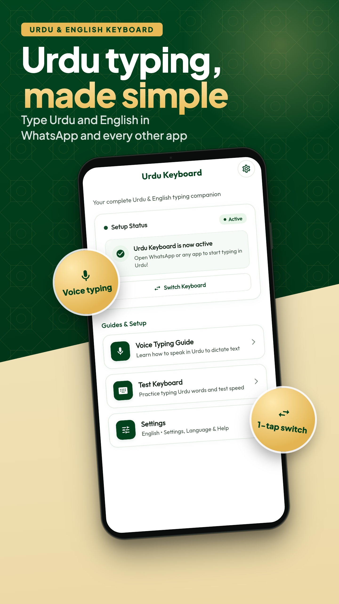
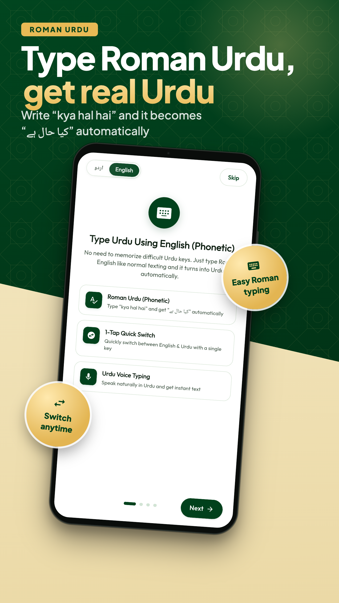
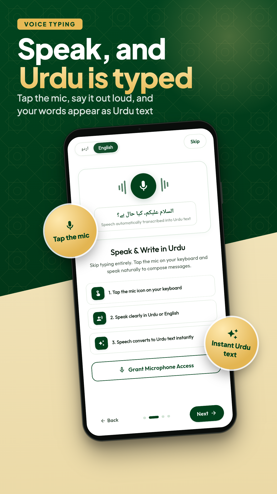
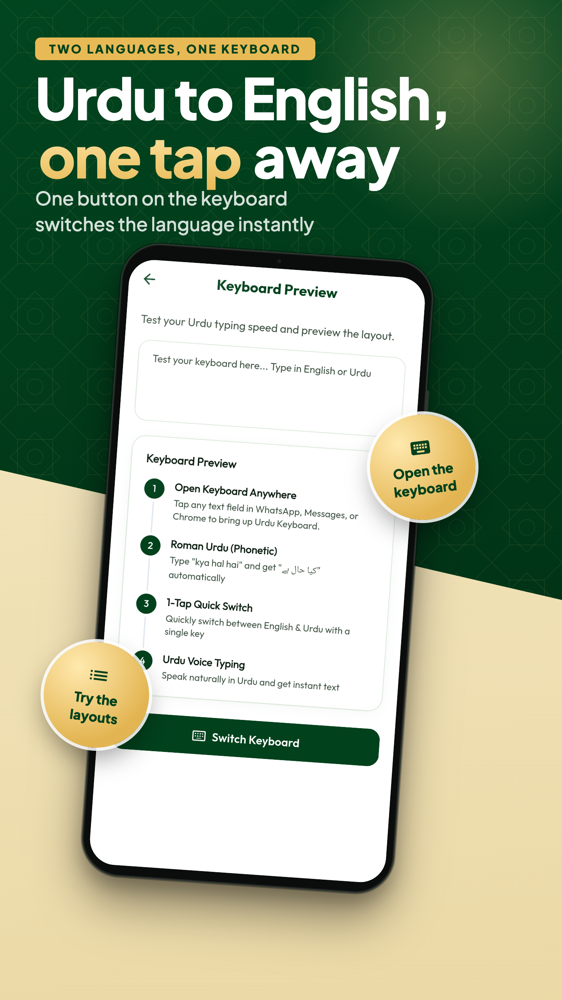
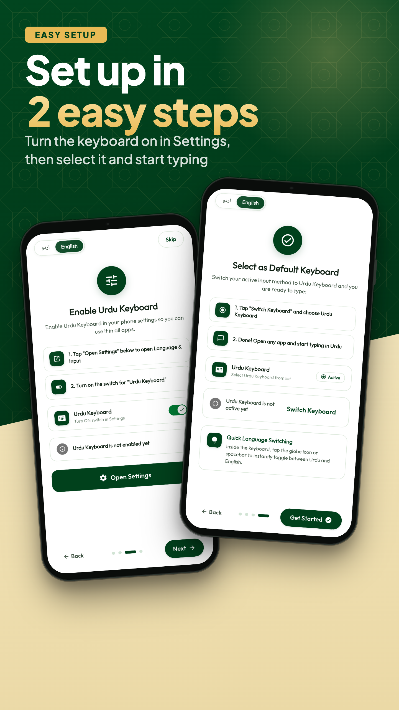
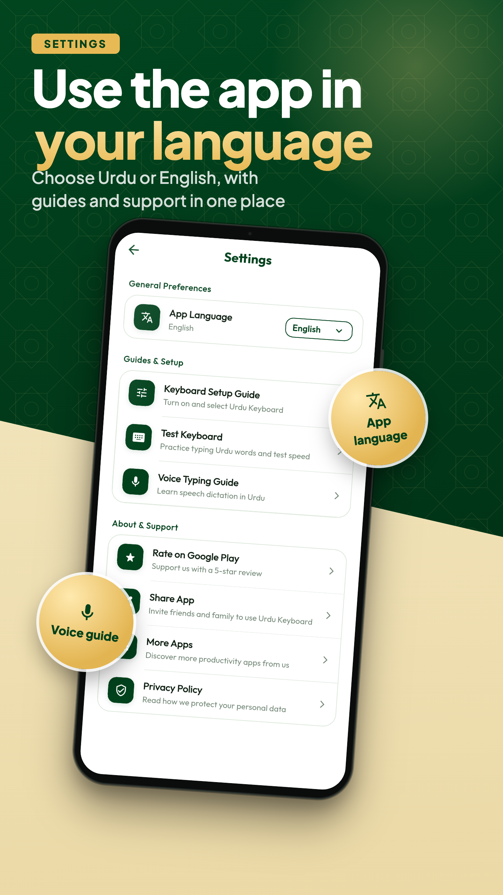

# Urdu Keyboard & Voice Typing

A production-grade, open-source Android Input Method Editor (IME) built with **Kotlin and Flutter**, engineered to deliver a responsive, zero-latency Urdu and English typing experience aligned with Google Gboard standards.

<div align="center">

<a href="https://play.google.com/store/apps/details?id=com.codexahmar.urdu_keyboard">
  
</a>

<br/>

[](https://flutter.dev)
[](https://kotlinlang.org)
[](https://developer.android.com)
[](https://developer.android.com)
[](LICENSE)

</div>

---

## Overview

Urdu Keyboard combines the speed of native Android system services with the user experience of Flutter. The system keyboard runs entirely in native **Kotlin** via Android's `InputMethodService` to guarantee hardware-accelerated 120Hz rendering, zero-latency touch response, and continuous text processing without window detachment. The accompanying Flutter application handles onboarding, guided system activation, text-scaling accessibility, and theme configuration.

---

## App Previews

<div align="center">

| Home Dashboard | Roman Urdu (Phonetic) | Urdu Voice Typing |
|:---:|:---:|:---:|
|  |  |  |

| 1-Tap Quick Switch | Guided Setup Flow | Settings & Themes |
|:---:|:---:|:---:|
|  |  |  |

</div>

---

## Core Capabilities

### Bilingual Suggestion & Prediction Engine
* **Statistical Unigram Model**: 730+ frequency-indexed Urdu words and 280+ common English words stored with probability weights.
* **Contextual Bigram Transitions (Next-Word Prediction)**: Predicts next words immediately upon committing text (e.g. `آپ` $\to$ `کیسے`, `عید` $\to$ `مبارک`, `thank` $\to$ `you`).
* **On-Device Personal Vocabulary**: Dynamically tracks your committed words with localized frequency increments, prioritizing your most typed vocabulary over generic dictionary defaults.
* **O(1) Bucket Indexing**: Letter-indexed prefix lookups eliminate collection scanning and garbage collection pauses during rapid typing.

### Phonetic Roman-to-Urdu Transliteration
* **Natural Roman Typing**: Type in English letters (`kya hal hai`) to generate authentic Urdu script (`کیا حال ہے`).
* **Greedy Tokenizer**: Evaluates trigraphs (`chh` $\to$ `چھ`), digraphs (`kh` $\to$ `خ`, `gh` $\to$ `غ`, `sh` $\to$ `ش`, `bh` $\to$ `بھ`), and aspirated single consonants in priority order.
* **Contextual Orthography**: Automatically applies initial Alif Madda (`aa` $\to$ `آ`) and trailing Noon Ghunna (`n` preceded by vowels $\to$ `ں`).

### Native Performance & Gesture Controls
* **In-Memory Zero-Detachment Layer Swaps**: Switching between English, Urdu, Symbols, and Emoji layers toggles view visibility in memory (0ms latency) without reconstructing the window or calling `setInputView()`.
* **Space Bar Cursor Glide**: Horizontal touch scrubbing across the space bar glides the editor cursor left and right with haptic tick feedback.
* **Accelerated Backspace**: Exponential hold-to-delete velocity curve for rapid paragraph and sentence clearing.
* **Multi-Touch Rollover**: Commits active keystrokes seamlessly when a second finger touches down during high-speed typing.

### Gboard-Standard Ergonomics & Theming
* **Key Dimensions**: 54dp key height with 8dp inter-row vertical spacing, matching standard Google Gboard touch targets.
* **Soft 3D Tactile Design**: 8dp squircle key corners with layered bottom shadow bevels (`layer-list` drawables) in both Light and Dark modes.
* **Adaptive Symbols Layer**:
  * **Urdu Mode**: Displays Urdu numerals (`۱, ۲, ۳, ۴, ۵, ۶, ۷, ۸, ۹, ۰`) and punctuation (`؟, ،, ۔, ؛, ٪`).
  * **English Mode**: Displays standard digits (`1, 2, 3, 4, 5, 6, 7, 8, 9, 0`) and symbols (`?, ,, ., ;, %`).
* **In-Place Emoji Search**: Embedded query capsule above the keyboard with a blinking cursor and bilingual keyword matching.
* **Hands-Free Dictation**: Google Speech Recognition integration for both Urdu (`ur-PK`) and English (`en-US`).

---

## System Architecture

```text
┌────────────────────────────────────────────────────────┐
│               Flutter Application Layer                │
│  • Onboarding & System IME Enablement Wizard           │
│  • Preference Management (Haptics, Themes, Scaling)    │
│  • Interactive Keyboard Preview & Voice Guide          │
└──────────────────────────┬─────────────────────────────┘
                           │ Platform Channels (IPC)
┌──────────────────────────▼─────────────────────────────┐
│           Native Android IME Engine (Kotlin)           │
│                                                        │
│  UrduKeyboardService (InputMethodService)              │
│  │                                                     │
│  └── KeyboardController (Orchestrator)                 │
│      ├── KeyboardLayerManager (Visibility & Insets)    │
│      ├── KeyTouchHandler (Gestures & Fast Tap)         │
│      ├── KeyboardSuggestionManager (N-Gram Pipelines)  │
│      │   ├── UrduSuggestionEngine (UrduLexicon)        │
│      │   ├── EnglishSuggestionEngine (EnglishLexicon)  │
│      │   └── PhoneticMapper (RomanUrduDictionary)      │
│      ├── EmojiSearchController (In-Place Filter)       │
│      ├── VoiceInputManager (Speech Recognition)        │
│      └── BackspaceHandler (Accelerated Repeat)         │
└────────────────────────────────────────────────────────┘
```

---

## Repository Structure

```text
android/app/src/main/kotlin/com/codexahmar/urdu_keyboard/
├── MainActivity.kt                      # Flutter activity host
├── channel/
│   └── FlutterChannelHandler.kt         # MethodChannel bridge between Flutter and Kotlin
├── keyboard/
│   ├── UrduKeyboardService.kt           # Native IME Service lifecycle entrypoint
│   ├── KeyboardController.kt            # High-level coordinator
│   ├── KeyboardLayerManager.kt          # Cached view hierarchy, insets, and layer toggles
│   ├── KeyTouchHandler.kt               # Touch dispatch, rollover, and space bar glide
│   ├── KeyboardSuggestionManager.kt     # Debounced suggestion coordinator
│   ├── UrduSuggestionEngine.kt          # Probabilistic Urdu word and bigram engine
│   ├── EnglishSuggestionEngine.kt       # English auto-completion and bigram engine
│   ├── PhoneticMapper.kt                # Algorithmic Roman-to-Urdu transliterator
│   ├── EmojiSearchController.kt         # In-place search query and horizontal results strip
│   ├── EmojiDictionary.kt               # Bilingual emoji keyword database
│   ├── BackspaceHandler.kt              # Accelerated hold-to-delete logic
│   ├── VoiceInputManager.kt             # Speech recognition manager
│   ├── KeyPopupOverlay.kt               # Floating preview bubble and variant selector
│   ├── KeyboardConstants.kt             # Compile-time key IDs, dimensions, and arrays
│   ├── UrduLexicon.kt                   # Urdu unigrams and bigram transition tables
│   ├── EnglishLexicon.kt                # English vocabulary and transition tables
│   └── RomanUrduDictionary.kt           # Roman phonetic mappings and orthography rules
└── utils/
    └── PreferenceHelper.kt              # Persistent settings and learned word frequencies
```

---

## Getting Started

### Prerequisites
* Flutter SDK (3.22 or higher)
* Android Studio / Android SDK (API 34+)
* JDK 17 or 21

### Build and Run

1. **Clone the repository:**
   ```bash
   git clone https://github.com/codexahmar/urdu-keyboard-voice-typing.git
   cd urdu-keyboard-voice-typing
   ```

2. **Fetch Flutter dependencies:**
   ```bash
   flutter pub get
   ```

3. **Deploy to a connected device:**
   ```bash
   flutter run
   ```

4. **Activate the Keyboard:**
   * Launch the app on your device and tap **Switch Keyboard**.
   * Toggle **Urdu Keyboard** on under `Settings > System > Languages & Input > On-screen keyboard`.

---

## Contributing

Contributions are welcome. If you would like to expand the vocabulary, refine phonetic rules, optimize performance, or report an issue, please follow these guidelines:

1. **Fork** the repository and create your branch from `main`:
   ```bash
   git checkout -b feature/your-feature-name
   ```
2. **Commit your modifications** with clear, descriptive messages:
   ```bash
   git commit -m "Enhance Urdu bigram transition probabilities"
   ```
3. **Verify the build**:
   ```bash
   ./android/gradlew -p android assembleDebug
   ```
4. **Push to your fork** and submit a **Pull Request**.

For bug reports or feature requests, please open an [Issue](https://github.com/codexahmar/urdu-keyboard-voice-typing/issues).

---

## License

This project is licensed under the MIT License. See the [LICENSE](LICENSE) file for complete terms.

---

## Author

**Ahmaryar Khan**  
* Mobile Software Engineer (Flutter & Android)  
* Google Play: [Urdu Keyboard on Play Store](https://play.google.com/store/apps/details?id=com.codexahmar.urdu_keyboard)
